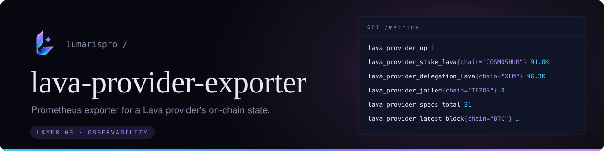

<p align="center">
  
</p>

Prometheus exporter for the on-chain state of a [Lava Network](https://lavanet.xyz) provider: stake, delegations, jails and reported blocks, per spec.

`lavap` exposes its own runtime metrics (relays, latency). This exporter covers the other half: what the **chain** thinks of the provider. A frozen or jailed spec shows up here even when the process itself looks healthy.

- One Python file, standard library only. No `pip install`.
- Polls the public Lava REST API in the background (default every 60 s) and serves the last result, so Prometheus scrapes never wait on the network.
- Works for any provider address; defaults to Lumaris.

## Run

```bash
python3 lava_provider_exporter.py --provider lava@15ngms6me8r486xs3nda0y6p2d56gym687etymg
curl -s localhost:9796/metrics
```

Check once without starting a server:

```bash
python3 lava_provider_exporter.py --once
```

| Flag | Default | |
|---|---|---|
| `--provider` | Lumaris | Provider address (`lava@1…`) |
| `--rest` | `https://lava.rest.lava.build` | Lava REST endpoint; point it at your own node if you run one |
| `--listen` | `0.0.0.0:9796` | Where `/metrics` is served |
| `--interval` | `60` | Seconds between polls |
| `--timeout` | `15` | HTTP timeout per request |

Each REST request gets up to two retries for timeouts, connection failures, or
HTTP 500, 502, 503, and 504 responses. The timeout applies to each attempt.
If the poll still fails, the exporter reports `lava_provider_up 0` and keeps the
last successful provider metrics.

### systemd

```bash
sudo install -D -m 0755 lava_provider_exporter.py /opt/lava-provider-exporter/lava_provider_exporter.py
sudo cp lava-provider-exporter.service /etc/systemd/system/
sudo systemctl daemon-reload && sudo systemctl enable --now lava-provider-exporter
```

### Docker

```bash
docker build -t lava-provider-exporter .
docker run -d -p 9796:9796 lava-provider-exporter --provider lava@1...
```

### Prometheus

```yaml
scrape_configs:
  - job_name: lava-provider
    scrape_interval: 60s
    static_configs:
      - targets: ["127.0.0.1:9796"]
```

## Metrics

| Metric | Labels | |
|---|---|---|
| `lava_provider_up` | | 1 if the last poll succeeded |
| `lava_provider_last_success_timestamp_seconds` | | Time of the last successful poll |
| `lava_provider_poll_duration_seconds` | | Duration of the last poll |
| `lava_provider_info` | `address`, `moniker`, `website` | Always 1 |
| `lava_provider_specs_total` | | Specs the provider is staked on |
| `lava_provider_self_delegation_lava` | | Provider's own delegation |
| `lava_provider_stake_lava` | `chain` | Stake on the spec |
| `lava_provider_delegation_lava` | `chain` | Delegations to the spec |
| `lava_provider_commission_percent` | `chain` | Delegator commission |
| `lava_provider_jailed` | `chain` | 1 while jailed |
| `lava_provider_jails_total` | `chain` | Times jailed |
| `lava_provider_jail_end_timestamp_seconds` | `chain` | End of the current or last jail |
| `lava_provider_latest_block` | `chain` | Latest block of the served chain, as last reported |
| `lava_provider_report_epoch` | `chain` | Lava epoch of that report |
| `lava_provider_stake_applied_block` | `chain` | Lava block the current stake was applied at |
| `lava_provider_endpoints` | `chain` | Registered endpoints |

Amounts are in LAVA (converted from `ulava`).

<details>
<summary>Sample output</summary>

```
lava_provider_up 1
lava_provider_info{address="lava@15ngms6me8r486xs3nda0y6p2d56gym687etymg",moniker="Lumaris",website="https://lumaris.space/"} 1
lava_provider_specs_total 31
lava_provider_self_delegation_lava 155240.0
lava_provider_stake_lava{chain="COSMOSHUB"} 5012.0
lava_provider_delegation_lava{chain="COSMOSHUB"} 96315.171765
lava_provider_commission_percent{chain="COSMOSHUB"} 75
lava_provider_jailed{chain="COSMOSHUB"} 0
lava_provider_jails_total{chain="COSMOSHUB"} 1
lava_provider_latest_block{chain="COSMOSHUB"} 33828849
lava_provider_endpoints{chain="COSMOSHUB"} 1
```

</details>

Dashboards and alert rules built on these metrics live in [grafana-dashboards](https://github.com/lumarispro/grafana-dashboards).

---

<sub>MIT · [lumaris.space](https://lumaris.space)</sub>
